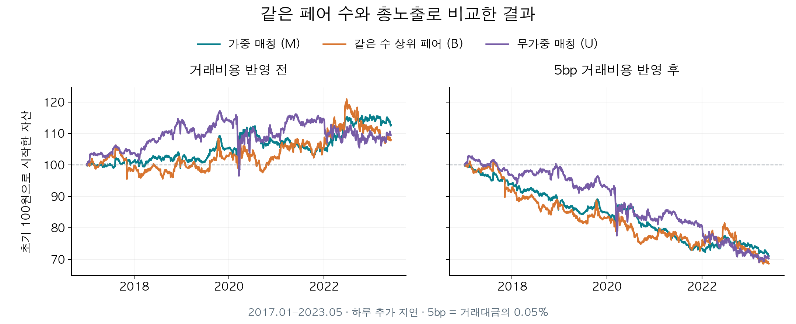

# 선행논문의 재현

이 저장소의 유일한 기준 모델은 **matching_q_v1**입니다. 선행논문의 매칭 아이디어를 바탕으로, 추가 검증에서 사용한 Q 전략과 공통 거래 장부를 확장 연구의 출발점으로 고정했습니다. 이전 재구성 모델과 원공개 코드 실행 패키지는 현재 파일에서 제거했습니다.

**현재 확인된 결론은 변동성 감소입니다.** 같은 페어 수와 실제 총노출에서 가중 매칭의 변동성은 비교군보다 약 35% 낮았지만, 샤프 우월성과 비용 후 수익성은 확인하지 못했습니다. 이 모델을 수익성이 입증된 전략으로 설명하지 않습니다.

## 결과 먼저 보기

- [검증 보고서](reports/validation.html): 주 분석, 비용·기간·데이터 품질 민감도와 신뢰구간
- [고정 규칙](config/model_spec.json): 이번 기준 모델의 정의와 해석 범위
- [전체 성과](results/metrics.csv) · [샤프와 위험 차이의 신뢰구간](results/bootstrap.csv)
- [원 논문 PDF](reports/PAPER_2403.07998v1.pdf) · [arXiv 원문](https://arxiv.org/html/2403.07998v1)
- [이번 정리의 삭제 목록과 용량](cleanup/report.html)

평가 기간은 2017-01-03~2023-05-31, 고유 거래일 1,613일입니다. 주 분석은 종목별 주문을 합산한 총노출 100%, 한 거래일 추가 체결 지연이며, 주된 통계 비교는 **5bp 비용에서 M−B 샤프 차이**입니다.

| 지표 | 가중 매칭 M | 같은 수 상위 페어 B |
|---|---:|---:|
| 비용 전 누적수익 | 12.78% | 7.92% |
| 비용 전 샤프 | 0.377 | 0.185 |
| 5bp 비용 후 누적수익 | −28.96% | −31.32% |
| 5bp 비용 후 샤프 | −0.976 | −0.676 |
| 5bp 비용 후 연 변동성 | 5.33% | 8.19% |

5bp는 거래대금의 0.05%로 논문의 비용 산식과 다른 민감도입니다. 주 분석의 샤프 차이 95% 구간은 [−0.900, 0.261], 변동성 비율 M/B 구간은 [0.567, 0.738]입니다. 말일 미청산 결측 보유분이 평가액에 포함되어 있으므로 최종 NAV는 전액 현금화된 금액이 아닙니다.



## 기준 모델의 구성

매월 그때까지의 504개 완전한 양수 가격으로 적격 종목을 정합니다. 양방향 로그 회귀와 AIC 기반 ADF를 계산하고, 각 무방향 페어에서는 더 음의 통계량을 갖는 방향을 공통으로 사용합니다. 전체 표본의 결측률로 종목을 미리 고르지 않습니다.

- **M:** −ADF 통계량의 합을 최대화하는 비중복 가중 매칭. 최대 페어 수를 우선하지 않습니다.
- **B:** 해당 월 M과 같은 K개의 상위 점수 페어. 종목 중복을 허용하는 비교군입니다.
- **U:** 점수를 쓰지 않는 고정된 무가중 비중복 조합. M과 같은 K개이며 무작위 조합 전체를 대표하지 않습니다.

월별 K는 223~233개입니다. 신호는 rolling504 회귀의 마지막 잔차를 연결한 Q20이며, 일별 회귀 캐시가 공개되지 않았던 부분에 대한 명시적 보완 가정입니다. 같은 날짜를 두 번 계산하지 않고, 신호·β·선정 지시를 함께 지연합니다. 각 비용 경로는 독립적인 수량·현금·NAV 장부로 비용을 지불하고 재투자합니다. 결측 시 수량을 동결하고 마지막 관측가격으로 평가하며, 말일에도 관측가격이 없는 보유분은 임의 청산하지 않습니다.

주 경로와 함께 총노출을 페어 합산 전 기준으로 맞추는 경우, 추가 지연이 없는 이상화, 비용 0·5·10bp, SRE·CPRT 제외 후 재선정을 보존했습니다. **45개 경로는 같은 기준 모델의 검증 조건**이며 좋은 결과를 골라 기준 모델로 바꾸지 않았습니다.

## 한 번에 재현하기

검증 환경은 Python 3.13.9입니다. 저장소 최상위에서 실행합니다.

```sh
python -m pip install -r requirements.txt
python reproduce.py
```

기본 실행은 보존된 77개월 선정 자료를 사용해 45개 거래 경로를 다시 계산하고, 독립 검산·통계·보고서를 갱신합니다. 이전에 확정된 기준 결과와 일별 수익, 비중, 주요 통계의 해시가 같은지도 확인합니다. 실패하면 중단되며 자세한 내용은 `checks/reproduction.log`에 남습니다.

원가격부터 전체 후보 그래프와 선정을 다시 계산하려면 다음과 같이 실행합니다.

```sh
python reproduce.py --rebuild-selection --workers 2
```

`config/model_spec.json`은 고정 규칙의 기록입니다. JSON을 편집해 계산 설정을 바꾸는 방식은 아니며, 실제 규칙은 `src/`에 구현되어 있습니다. 연구 확장 결과는 이 기준 결과와 구분하고, 무엇을 바꿨는지 명시해 같은 입력·기간·회계·비용 조건으로 비교합니다.

## 파일 역할

| 파일·폴더 | 역할 |
|---|---|
| `reproduce.py` | 선정 확인→거래→독립 검산→통계·보고서의 단일 실행 진입점 |
| `src/numerics.py` | 검증된 로그 회귀·ADF·rolling 잔차 계산 |
| `src/selection.py` | 월별 M·B·U 선정과 SRE·CPRT 제외 민감도 |
| `src/backtest.py` | Q 신호와 거래 지시, 비용별 수량·현금·NAV 장부 |
| `src/verify.py` | 손계산 사례, 미래가격 변조 검사, 실제 보유 비중에서 장부 독립 재계산 |
| `src/analyze.py` | 성과·공동 날짜 블록 신뢰구간·그림·한국어 보고서 |
| `data/` | 원가격 한 부, 실제 월별 선정, 출처·라이선스와 두 가격 불연속의 근거 |
| `config/` | 고정한 기준 모델 명세 |
| `results/` | 45개 일별 경로, 주 분석의 종목 비중, 통계와 그림 |
| `checks/` | 독립 검산, 수치 이관의 동일성, 재현 기록과 입력 해시 |
| `reports/` | 현재 검증 보고서와 선행논문 |
| `cleanup/` | 삭제 경로·용량 기록만 보관하며 삭제한 파일 내용이나 백업은 없음 |

## 해석 범위와 출처

이 비교는 **선정 정책 전체의 차이**를 평가합니다. 중복 제거만의 순수 인과효과를 분리하지 않으며, 같은 과거 자료를 재사용한 결과로 새로운 독립 표본 검증도 아닙니다. 원파일 505개 종목의 당시 지수 구성·생존편향, 모든 기업행동과 장기 결측 정산, 대차료·시장 충격까지 해결한 실전 결과로 해석하지 않습니다.

원가격은 [공개 저장소](https://github.com/jingmouren/kai-trading-bot-pair)의 커밋 `aaac6d999d6b077304a887caff2aab514d7ea6a2`에 있던 파일입니다. SHA-256은 `7605eab6525ddb5db66965d1559a56b48375f11a14cd1040eaa12318a545939c`입니다. [출처](data/provenance.json), [가격 불연속 근거](data/quality_notes.json), [보존한 원저장소 라이선스](data/SOURCE_LICENSE.txt)를 함께 제공합니다.

월별 선정 메타데이터의 생성 당시 코드 식별자는 원래 값을 보존했습니다. 현재 독립 모듈과의 계산 동일성은 `checks/numeric_migration.json`과 `checks/trading_migration.json`에 연결되어 있으며, 과거 폴더는 실행에 필요하지 않습니다.
