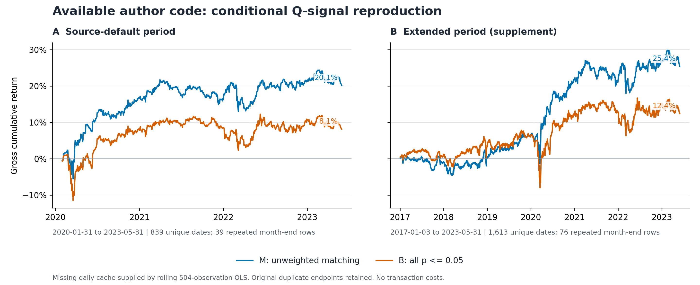

# 선행논문 공개 코드 재현

이 저장소의 유일한 현재 기준은 **`author_code_aaac6d9_q_replay`**입니다. [Khizar Qureshi·Tauhid Zaman의 논문](https://arxiv.org/abs/2403.07998)이 공개한 코드의 [보존본 `aaac6d9`](https://github.com/jingmouren/kai-trading-bot-pair/tree/aaac6d999d6b077304a887caff2aab514d7ea6a2)을 기준으로, 남아 있는 연산을 보존하고 누락된 실행 연결부와 일별 회귀 캐시를 보완했습니다. 결과는 **Q 신호 M/B 두 전략의 조건부 실행**이며, 논문 표 2·3의 정확한 재현을 뜻하지 않습니다. 이전 모델은 Git의 부모 커밋에만 보관됩니다.

[한국어 HTML 보고서](reports/REPORT_KO.html) · [성과 원표](results/metrics.csv) · [비교 CSV](results/reference_comparison.csv) · [전체 소스 출처](checks/source_manifest.json)

## 결과

| 실행 범위 | 전략 | 비용 전 누적수익 | 샤프 | 소르티노 | 고유 날짜 / 계산행 / 중복행 |
|---|---|---:|---:|---:|---:|
| 원코드 기본 기간<br>2020-01-31~2023-05-31 | M: 실제 무가중 매칭 | 20.11% | 0.7742 | 1.1062 | 839 / 878 / 39 |
| 원코드 기본 기간<br>2020-01-31~2023-05-31 | B: p≤0.05 전체 | 8.10% | 0.3217 | 0.4271 | 839 / 878 / 39 |
| 2017년까지 확장한 보조 실행<br>2017-01-03~2023-05-31 | M: 실제 무가중 매칭 | 25.39% | 0.5982 | 0.8470 | 1,613 / 1,689 / 76 |
| 2017년까지 확장한 보조 실행<br>2017-01-03~2023-05-31 | B: p≤0.05 전체 | 12.38% | 0.2998 | 0.3966 | 1,613 / 1,689 / 76 |

`source_default`는 공개 `run_history`의 `202*.csv` 필터를 유지한 주 실행입니다. `extended_2017`은 같은 거래 연산에서 날짜 범위를 2017년까지 넓힌 보조 실행입니다. 표본 기간이 다르므로 두 실행의 성과를 직접 우열로 해석하지 않습니다. 샤프·소르티노·복리·단순 누적수익은 원코드의 산식과 결측 처리 규칙을 사용합니다.



월별 거래 구간의 양끝을 모두 포함하기 때문에 같은 월말이 두 번 들어갑니다. 고유 날짜와 계산행 수를 함께 보아야 합니다. `max_drawdown_supplement`는 초기자산 1을 포함한 자산곡선에서 추가 계산한 보조 지표이며 원소스 출력이 아닙니다. 활성 코드에 거래비용 계산이 없어 비용 후 성과는 생성하지 않았습니다.

## 실행 확인과 독립 검산

최신 결과의 검산 통과와 77개월 산출물 개수를 확인했습니다. 원가격 전체 재계산 이력과 최근 실행의 캐시 재사용 여부는 아래 기록에서 구분합니다.

| 확인 항목 | 상태 | 근거 |
|---|---|---|
| 최근 실행 방식 | 검증된 캐시 재사용 가능; 실제 재계산 수는 execution.json 참조 | [run_start.json](checks/run_start.json) |
| 월별 선정 파일 | 77 / 77개 | 생성 파일 개수 |
| 월별 거래 완료 기록 | 77 / 77개 | 생성 파일 개수 |
| 월별 두 전략 수익 파일 | 154 / 154개 | 생성 파일 개수 |
| 실행 종료 기록 | 2026-10-29T08:15:27.290426+00:00 | [execution.json](checks/execution.json) |
| 독립 완료 확인서 | 통과 확인 | [fresh_reproduction.json](checks/fresh_reproduction.json) |
| 원가격 전체 재계산 기록 | 2026-10-29T08:13:43.785799+00:00 | [full_recomputation.json](checks/full_recomputation.json) |

시작 선언, 파일 개수, 실행 종료 기록과 검산 결과는 서로 다른 증거입니다. 완료 여부는 [fresh_reproduction.json](checks/fresh_reproduction.json)의 `passed`와 실제 산출물을 함께 확인합니다. `data/prices.parquet.gz`에서 선정·거래를 생성하며, 다른 모델의 선정·신호 캐시는 입력으로 사용하지 않습니다.

독립 검산 자료:

- [full_recomputation.json](checks/full_recomputation.json): 통과 표시.
- [selection_validation.json](checks/selection_validation.json): 통과 표시.
- [trading_validation.json](checks/trading_validation.json): 통과 표시.

원격 커밋의 텍스트 파일 10개와 가격 파일 1개의 Git blob·SHA-256 식별은 [source_manifest.json](checks/source_manifest.json)의 `verified_files`에, 시작 기록은 [run_start.json](checks/run_start.json)에 있습니다. 환경 버전은 [requirements.txt](requirements.txt)와 개별 검산 JSON을 참조합니다. 검산 통과는 기록된 표본과 연산 대조의 범위이며, 누락된 저자 캐시 자체를 복구했다는 뜻은 아닙니다.

## 논문 및 노트북과 비교

| 자료 | 전략·기간 | 샤프 | 복리 누적수익 |
|---|---|---:|---:|
| 이번 공개 코드 실행 | MAX_WEIGHT; 원코드 기본 기간 | 0.7742 | 20.11% |
| 이번 공개 코드 실행 | BASELINE; 원코드 기본 기간 | 0.3217 | 8.10% |
| 이번 공개 코드 실행 | MAX_WEIGHT; 2017년까지 확장한 보조 실행 | 0.5982 | 25.39% |
| 이번 공개 코드 실행 | BASELINE; 2017년까지 확장한 보조 실행 | 0.2998 | 12.38% |
| 논문 표 2 (gross) | MQ; 2017-01~2023-05 | 1.2300 | 73.65% |
| 논문 표 2 (gross) | BQ; 2017-01~2023-05 | 0.3400 | 17.96% |
| QSCORE 과거 저장 출력 | MAX_WEIGHT_Q_saved; 정확한 날짜 불명 | 1.4082 | 41.03% |

**서로 다른 조건의 수치를 병기한 표**입니다. 정확한 재현 오차나 투자전략의 성과 순위로 해석하지 않습니다. [reference_comparison.csv](results/reference_comparison.csv)는 자료 종류·기간·출처·조건 차이를 행마다 기록합니다. CSV 수익률의 단위는 1=100%입니다.

- [논문 표 2](https://arxiv.org/html/2403.07998v1#S5.SS2)의 MQ/BQ는 2017년 1월~2023년 5월 gross 결과입니다. MQ 누적수익은 73.65%, BQ는 17.96%입니다. 논문 M은 가중 매칭, B는 상위 250개 페어여서 이번 원코드 실행의 선정 방식과 다릅니다.
- [QSCORE.ipynb](source/QSCORE.ipynb) 과거 저장 출력은 샤프 1.408189, 누적수익 41.0308%입니다. 저장 그래프 눈금은 2020-01~2023-05 부근이지만 정확한 날짜와 입력 캐시가 없습니다. 해당 커밋의 실행 함수에는 미정의 이름·반환 누락이 있고, 저장 그래프와 현재 보고 함수도 달라 동일 환경의 정답 값으로 확정할 수 없습니다.
- [clean_zscore.ipynb](source/clean_zscore.ipynb)의 샤프 1.846576, 누적수익 14.9135%도 과거 저장 출력입니다. 호출하는 `fetch_performance`가 공개 소스에 없어 이번 Z 재현 결과로 사용하지 않습니다.
- [report.ipynb](source/report.ipynb)의 BASELINE/MAX_WEIGHT/MAXIMAL/APPROX_MAXIMAL은 매칭 방식별 과거 캐시 보고서입니다. 논문 MQ/MZ/BQ/BZ와 구분이 다릅니다. 저장 텍스트·표·호출식은 [notebook_reference.json](checks/notebook_reference.json)에 있으며, 노트북 셀은 실행하지 않았습니다.

## 보존한 연산과 보완 가정

| 항목 | 이번 실행 | 논문 및 재현 해석 |
|---|---|---|
| M 선정 | `rating`을 매칭 함수의 `weight`로 전달하지 않는 원동작 유지; 월별 205~216개 | 실제로는 무가중 최대 개수 매칭 |
| B 선정 | p≤0.05인 모든 방향별 페어; 월별 20,876~61,791개 | 상위 250개 선정·역방향 중복 제거 없음 |
| 후보·ADF | `betas.py`의 양방향 페어, 전체 기간 수익률 결측 5% 미만 유니버스, 기본 AIC 자동시차 ADF | 논문의 단일 시차 설명과 다름 |
| 일별 SPREAD·BETA | 504개 관측치의 rolling 로그 OLS에서 당일 잔차·계수 생성 | **공개되지 않은 생성기에 대한 보완 가정** |
| Q | 20일 중앙값·사분위수, Q25−Q75 분모, sign×round, 1행 지연 | 원코드 부호·반올림·shift 유지 |
| 손익·자본 | 당일 β의 주식 수 비율, 당일 가격 자본 분모, 원본 결측 처리 | 실전 체결·회계 검증과 별개 |
| 월말 | 양끝 포함 구간을 이어 붙여 중복 유지 | 같은 날 수익이 두 번 복리 반영될 수 있음 |
| Z·거래비용 | 활성 경로가 없거나 호출 함수 누락 | 임의로 추가하지 않음 |

실행 연결부 보완에는 로컬 경로, 누락 페어 reader, 미정의 함수 연결·반환값·실행 순서가 포함됩니다. 계산 가속용 벡터화는 독립 원함수 대조 자료와 함께 제공합니다. Python 해시 시드 0으로 현재 실행의 매칭 순서를 고정했지만, 저자의 당시 환경과 동점 처리 순서까지 복구한 것은 아닙니다.

월말까지의 자료로 선정한 페어가 같은 날의 전날 대비 수익에도 적용됩니다. 당일 β·자본 분모, 전체 기간 유니버스와 중복 월말도 남아 있습니다. 따라서 이 결과는 공개 소스의 동작을 확인하는 연구 자료이며, 미래정보를 배제한 투자수익이나 매칭의 일반적 우월성을 입증하지 않습니다.

## 재실행

저장소 최상위 폴더에서 실행합니다. `reproduce.py` 기본 실행은 해시 검증을 거친 기존 캐시를 재사용해 집계·검산·보고서를 갱신합니다.

```sh
python -m pip install -r requirements.txt
python reproduce.py
```

원가격부터 선정 77개월과 M/B 거래를 **전부 새로 계산**하려면 `--fresh`를 사용합니다. 이 명령은 같은 출력 위치의 생성 캐시와 결과를 갱신합니다.

```sh
python reproduce.py --fresh --workers 2 --selection-workers 4
```

기존 결과의 README·HTML·그림만 갱신하려면 `python src/report.py`를 실행합니다. `src/run.py`는 하위 실행 경로입니다. 자세한 옵션은 `python reproduce.py --help`에서 확인합니다. Python·라이브러리 환경은 `requirements.txt`와 개별 검산 JSON을 참조합니다.

| 경로 | 역할 |
|---|---|
| [reproduce.py](reproduce.py) | 기본: 검증 캐시 재사용; `--fresh`: 전체 재계산·검산·보고서 생성 |
| [src](src/) | 선정·거래·집계·검산·보고서 코드 |
| [source](source/) | 고정 커밋의 원본 Python·노트북·라이선스 10개 텍스트 파일 |
| [data/prices.parquet.gz](data/prices.parquet.gz) | 고정 원가격 입력 |
| [data/selection](data/selection/) | 새로 계산한 77개월 선정 |
| [results](results/) | 월별 두 전략의 수익, 두 기간의 일별 CSV, 성과·비교표 |
| [checks](checks/) | 출처·시작 선언·독립 검산·완료 근거 |
| [reports](reports/) | 한국어 HTML 보고서와 누적수익 PNG |

원가격 SHA-256: `7605eab6525ddb5db66965d1559a56b48375f11a14cd1040eaa12318a545939c`.

원소스 라이선스는 [source/LICENSE](source/LICENSE)에 보존합니다. 코드와 가격 파일의 출처는 위 manifest를 따릅니다.
