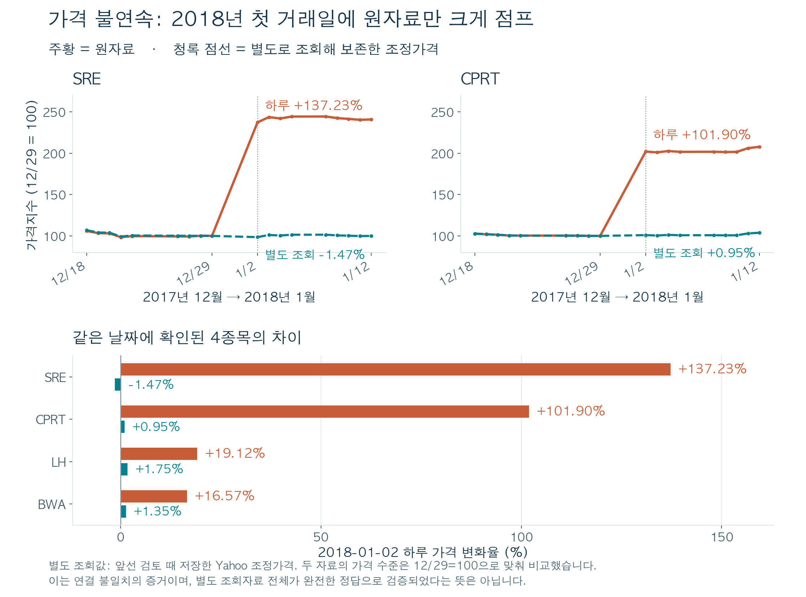
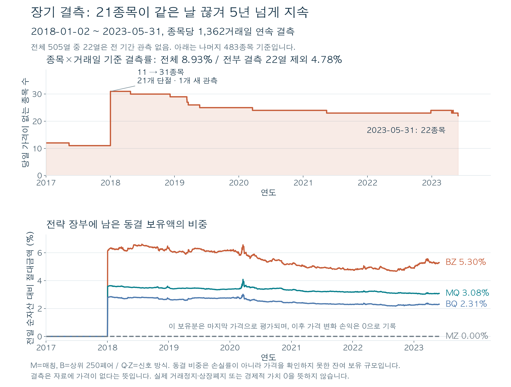

# 선행논문의 재현

[Pairs Trading Using a Novel Graphical Matching Approach](https://arxiv.org/html/2403.07998v1)를 바탕으로 재구성한 페어트레이딩 연구 모델입니다. 최종 검토에서 수정한 구현, 사용 데이터, 재현 결과와 독립 검산 자료를 함께 보관합니다.

주 분석은 매칭 방식 M과 비교 방식 B에 각각 Q·Z 신호를 적용한 **4개 전략**이며, 기존 보조 시나리오 **16개**를 포함해 총 20개 경로를 재현합니다. 평가 기간은 **2017-01-03~2023-05-31, 1,613거래일**입니다.

## 먼저 읽을 자료

- [전체 모델 설명서 PDF](final_model/reports/MODEL_GUIDE_KO.pdf): 선정, 신호, 거래, 위험 분해와 검토 결론
- [현재 파일 구조와 각 코드의 역할](final_model/README.html): 내려받은 뒤 브라우저에서 열 수 있는 안내서
- [성과 지표 100개](final_model/results/metrics.csv): 20개 경로와 5개 비용 기준
- [독립 검산 결과](final_model/audit/verification.json) 및 [전체 재현 기록](final_model/audit/reproduction_manifest.json)

## 재현 방법

검증에 사용한 환경은 Python 3.13.9입니다. 저장소 최상위 폴더에서 실행합니다.

```sh
python -m pip install -r final_model/requirements.txt
python final_model/src/run.py
```

기본 실행은 함께 제공한 77개월의 선정·신호 자료를 사용해 20개 경로, 성과 통계, 독립 검산과 진단 그래프를 다시 생성합니다. 기존 `results/`, `reports/`, `audit/`의 계산 산출물이 갱신됩니다.

원가격에서 신호를 다시 계산하거나, 후보 그래프와 페어 선정부터 다시 계산하려면 다음 옵션을 사용합니다. 전체 선정 재계산에는 더 많은 시간이 필요합니다.

```sh
python final_model/src/run.py --rebuild-features --workers 2
python final_model/src/run.py --rebuild-selection --workers 2
```

## 파일 구성

| 경로 | 역할 |
| --- | --- |
| `final_model/src/` | 실행·전처리·거래 장부·통계·독립 검산·진단을 담당하는 9개 Python 파일 |
| `final_model/config/` | 고정 모델의 선언 명세 |
| `final_model/data/` | 원가격, 77개월 선정·신호 자료, 가격 비교 자료와 출처 |
| `final_model/results/` | 일별 수익, 자산 비중, 페어·동결 장부, 성과 및 위험 통계 |
| `final_model/reports/` | 모델 설명서, 선행논문, 가격 불연속·장기 결측 그래프와 진단 표 |
| `final_model/audit/` | 재현 로그, 파일 해시, 독립 검산과 이관 대조 결과 |
| `cleanup_log/` | 이전 실험 파일을 정리한 삭제 목록과 용량 기록 |

`config/model_spec.json`은 모델을 설명하는 명세입니다. 실행 설정을 일괄 변경하는 입력 파일은 아니며, 실제 계산 규칙은 `src/`에 구현되어 있습니다. 보존된 이전 검토 문서에 나오는 옛 경로는 당시 검토 이력이고, 현재 실행에는 위 구조를 사용합니다.

## 검증 범위와 데이터 한계

정리 후 전체 20개 경로와 100개 성과 지표를 재실행했고, 저장된 수량·현금 장부를 독립 계산해 대조했습니다. 원가격 표본의 OLS·ADF 계산, 작은 그래프의 최적 선정, 실제 2017년 1월 전체 후보 그래프도 검산했습니다. 정리 과정에서 77개월 전체 후보 그래프를 모두 새로 계산한 것은 아니며, 그 재계산은 위 옵션으로 실행할 수 있습니다.

이 모델은 **한계를 명시한 연구용 기준 구현**입니다. 원자료에는 가격 불연속과 장기 결측이 있고, 당시 구성종목·기업행동·정산 정보를 완전히 확보하지 못했습니다. 종가 체결과 결측 보유분의 수량 동결 등도 계산 가정입니다. 따라서 결과를 역사적으로 실현 가능한 투자수익이나 매칭 방식의 일반적 우월성으로 해석하지 않습니다. 자세한 판단은 [독립 검토 기록](final_model/audit/AUDIT_KO.txt)에 있습니다.





## 출처

- 선행논문: [arXiv 2403.07998v1](https://arxiv.org/html/2403.07998v1)
- 원자료 저장소: [jingmouren/kai-trading-bot-pair](https://github.com/jingmouren/kai-trading-bot-pair), 기준 커밋 `aaac6d999d6b077304a887caff2aab514d7ea6a2`
- 입력 파일과 비교 자료의 식별 정보: [provenance.json](final_model/data/provenance.json)
- 원 저장소의 보존 라이선스: [SOURCE_LICENSE.txt](final_model/data/SOURCE_LICENSE.txt)

이 저장소는 정리 후 남은 현재 파일로 시작합니다. 이전 로컬 Git 이력과 삭제한 실험 파일은 포함하지 않습니다.
